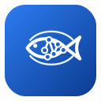

# Dory Code



Dory Code is an independently maintained fork of [Zoo Code](https://github.com/Zoo-Code-Org/Zoo-Code). It uses the Apache 2.0 license. Build and install the [local VSIX](#manual-vsix-installation) to use the fork.

The artwork comes from [Dory Memory](https://github.com/e3742526/dory-memory).

## About the upstream project

> Zoo Code continues development of this project after the Roo team wound down
> active Roo Code work to focus on [Roomote](https://roomote.dev/). Thank you
> to the Roo team for everything they built.
>
> The core team is a group of developers who contributed to Roo previously and
> care deeply about this plugin. We will continue to make model updates, fix
> bugs, and release features, and we plan to listen closely to the community
> that made this plugin so special. Join us on
> [Discord](https://discord.gg/VxfP4Vx3gX),
> [Reddit](https://www.reddit.com/r/ZooCode), or
> [open a PR or issue](https://github.com/Zoo-Code-Org/Zoo-Code).
>
> _-Zoo Code Team_

## Roo Code to Zoo Code migration

The upstream [Roo Code to Zoo Code migration guide](https://docs.zoocode.dev/roo-to-zoo-migration) covers those two extensions.

## What Zoo Code Has Added Since Roo Code

Zoo Code builds on the foundation created by Roo Code and continues to expand it with:

- **Semble codebase intelligence** — semantic code search on demand. Use an existing installation or set `SEMBLE_BINARY_PATH` to the absolute path of a locally installed executable.
- **Stronger Orchestrator workflows** — safer delegation, parallel task coordination, reliable parent/child task recovery, and better isolation between subtasks and provider profiles.
- **Longer autonomous runs with Destructive Command Guard (DCG)** — automatically block dangerous commands while trusted work continues without repeated approval prompts.
- **The latest models** — ongoing support for new Claude, GPT, Gemini, Kimi, GLM, Grok, MiniMax, and other model families.
- **More ways to connect** — new and expanded providers including Moonshot, Kimi Code, Kenari, Friendli, OpenCode Go, and many more.
- **More dependable terminal and editing workflows** — fixes for premature terminal completion, task-state races, context management, diff editing, and provider-specific tool use.
- **More control over your workspace** — rules management, per-mode MCP restrictions, multi-root path controls, model reasoning options, and completion change review actions.

## What Dory Code changes

Dory Code removes the upstream account, gateway, billing, and analytics services. It also adds fixes that the fork needs for local work:

- **Local-first runtime.** The fork starts no analytics client. Saved Zoo Gateway profiles and task history stay, and the retired provider asks you to select a different provider. See [standalone independence](docs/standalone-independence.md).
- **OpenRouter.** Catalog and endpoint discovery use your configured base URL and copy only the selected model. Prompt caching uses catalog capabilities. A hashed `session_id` keeps cache routing stable within a task, and a canceled task stops its request.
- **Current models only.** Model lists do not show a model released more than 24 months ago. Bundled catalogs record each release date, and OpenRouter supplies its listing date. A profile that already uses an older model keeps it.
- **Long MCP tool names.** A name over 64 characters becomes a stable alias (`mcp--0--<hint>_<hash>`). Saved history with old names is repaired in the request copy.
- **No workspace.** Open file tabs and `@` mentions work without a workspace folder. The environment details do not list the home directory.
- **Commit messages.** Draft a commit message from the staged changes in Source Control. See [Draft commit messages](#draft-commit-messages).
- **Privacy.** The fork collects no data and has no server. Prompts and files go only to the provider that you configure. See [PRIVACY.md](PRIVACY.md).
- **Performance work.** [Optimization review](docs/optimization-review-2026-11-24.md) lists each finding and its status. The upstream survey is in [gem-hydro-parentrepo-survey-24NOV2026.md](gem-hydro-parentrepo-survey-24NOV2026.md).

## Draft commit messages

Select the bubbles in Git Source Control to draft a message in the commit input box. Review the draft before you commit.

**Default (Automatic)** tries signed-in services, then CLI agents, then saved API profiles. The CLI group includes the Dory wrapper if the `dory` CLI is installed. To pick one provider, run **Dory Code: Set Commit Message Provider** from the Command Palette.

Dory Code uses the staged changes. By default, it stages all changes if the index is empty. Set `pet-zoo-code.commitMessage.autoStage` to `never` to stage files yourself, or to `always` to stage all changes each time.

Dory Code sends the staged diff to the selected provider. It masks common secret formats first, but it cannot find every secret. If the staged changes or the commit input box change while the draft runs, Dory Code discards the draft. The command does not run in an untrusted workspace.

## Upstream base: Zoo Code v3.98.2

Dory Code is based on Zoo Code v3.98.2. That release added:

- 🔌 Models: Use Gemini 3.8 Flash and the new Gemini 4 Carbon, Hydrogen, and Neon models, with `xhigh` thinking levels on Gemini.
- 🔧 Fixes and provider support: Stop Vertex Gemini requests that end with a model turn, keep Gemini thought signatures intact through LiteLLM, condense Ollama tasks at the configured context limit, and turn on Responses API support for OpenAI Compatible providers.

<details>
  <summary>🌐 Available languages</summary>

- [English](README.md)
- [Català](locales/ca/README.md)
- [Deutsch](locales/de/README.md)
- [Español](locales/es/README.md)
- [Français](locales/fr/README.md)
- [हिंदी](locales/hi/README.md)
- [Bahasa Indonesia](locales/id/README.md)
- [Italiano](locales/it/README.md)
- [日本語](locales/ja/README.md)
- [한국어](locales/ko/README.md)
- [Nederlands](locales/nl/README.md)
- [Polski](locales/pl/README.md)
- [Português (BR)](locales/pt-BR/README.md)
- [Русский](locales/ru/README.md)
- [Türkçe](locales/tr/README.md)
- [Tiếng Việt](locales/vi/README.md)
- [简体中文](locales/zh-CN/README.md)
- [繁體中文](locales/zh-TW/README.md)

</details>

---

## What Dory Code can do

- Generate Code from natural language descriptions and specs
- Adapt with Modes: Code, Architect, Ask, Debug, and Custom Modes
- Refactor & Debug existing code
- Write & Update documentation
- Answer Questions about your codebase
- Automate repetitive tasks
- Utilize MCP Servers

## Modes

Dory Code includes these modes:

- Code Mode: everyday coding, edits, and file ops
- Architect Mode: plan systems, specs, and migrations
- Ask Mode: fast answers, explanations, and docs
- Debug Mode: trace issues, add logs, isolate root causes
- Custom Modes: build specialized modes for your team or workflow

Learn more: [Using Modes](https://docs.zoocode.dev/basic-usage/using-modes) •
[Custom Modes](https://docs.zoocode.dev/advanced-usage/custom-modes)

## Upstream Zoo Code resources

- **[Documentation](https://docs.zoocode.dev):** The official guide to
  installing, configuring, and mastering Zoo Code.
- **[Discord Server](https://discord.gg/VxfP4Vx3gX):** Join the community for
  real-time help and discussion.
- **[Reddit Community](https://www.reddit.com/r/ZooCode/):** Share your
  experiences and see what others are building.
- **[GitHub Issues](https://github.com/Zoo-Code-Org/Zoo-Code/issues):** Report
  bugs and track development.
- **[Feature Requests](https://github.com/Zoo-Code-Org/Zoo-Code/discussions/categories/feature-requests?discussions_q=is%3Aopen+category%3A%22Feature+Requests%22+sort%3Atop):**
  Have an idea? Share it with the developers.

---

## Local Setup & Development

1. **Clone** the repo:

```sh
git clone https://github.com/e3742526/Pet-Zoo-Code.git
```

2. **Install dependencies**:

```sh
pnpm install
```

3. **Run the extension**:

There are several ways to run the Dory Code extension.

### Development Mode (F5)

For active development, use VSCode's built-in debugging:

Press `F5` (or go to **Run** → **Start Debugging**) in VSCode. This will open a
new VS Code window with the Dory Code extension running.

- Changes to the webview will appear immediately.
- Changes to the core extension will also hot reload automatically.

### Automated VSIX Installation

To build and install the extension as a VSIX package directly into VSCode:

```sh
pnpm install:vsix [-y] [--editor=<command>]
```

This command will:

- Ask which editor command to use (code/cursor/code-insiders) - defaults to
  'code'
- Replace an existing Dory Code installation.
- Build the latest VSIX package.
- Install the newly built VSIX.
- Prompt you to restart VS Code for changes to take effect.

Options:

- `-y`: Skip all confirmation prompts and use defaults
- `--editor=<command>`: Specify the editor command (e.g., `--editor=cursor` or
  `--editor=code-insiders`)

### Manual VSIX Installation

If you prefer to install the VSIX package manually:

1. First, build the VSIX package:
    ```sh
    pnpm vsix
    ```
2. A `.vsix` file will be generated in the `bin/` directory (e.g.,
   `bin/pet-zoo-code-<version>.vsix`).
3. Install it manually using the VSCode CLI:
    ```sh
    code --install-extension bin/pet-zoo-code-<version>.vsix
    ```

### Transfer from a Zoo Code installation

1. In Zoo Code, complete or stop active tasks. Open **Settings → About** and select **Export** under **Manage Settings**. Import the file from the same screen in Dory Code. Treat the export as private because it can contain provider API keys.
2. Copy any VS Code settings you want to keep from `zoo-code.*` to `pet-zoo-code.*`. Use a different custom storage folder for each extension.
3. Run **Dory Code: Import Zoo Code Task History** from the Command Palette. Dory Code copies saved task history and conversations into its own store and skips tasks already present. Checkpoint repositories stay in the original store.
4. Sign in again to any subscription providers that you use. For OpenRouter, use **Get OpenRouter API Key** and paste the authorization code from the browser. For a custom OpenRouter endpoint, enter the API key for that endpoint.

For a managed installation, the administrator can supply the same provider allowlist through `ROO_CODE_CLOUD_ORG_SETTINGS` before launching VS Code. The variable takes a base64-encoded JSON object with `allowList` and an optional `version`. This also covers installations that only have a policy cached under the old extension ID.

---

We use [changesets](https://github.com/changesets/changesets) for versioning and
publishing. Check our `CHANGELOG.md` for release notes.

---

## Upstream disclaimer

**Please note** that Zoo Code does **not** make any representations or
warranties regarding any code, models, or other tools provided or made available
in connection with Zoo Code, any associated third-party tools, or any resulting
outputs. You assume **all risks** associated with the use of any such tools or
outputs; such tools are provided on an **"AS IS"** and **"AS AVAILABLE"** basis.
Such risks may include, without limitation, intellectual property infringement,
cyber vulnerabilities or attacks, bias, inaccuracies, errors, defects, viruses,
downtime, property loss or damage, and/or personal injury. You are solely
responsible for your use of any such tools or outputs (including, without
limitation, the legality, appropriateness, and results thereof).

---

## Contributing

We love community contributions! Get started by reading our
[CONTRIBUTING.md](CONTRIBUTING.md).

---

## License

[Apache 2.0 © 2026 Zoo Code Org](./LICENSE)
